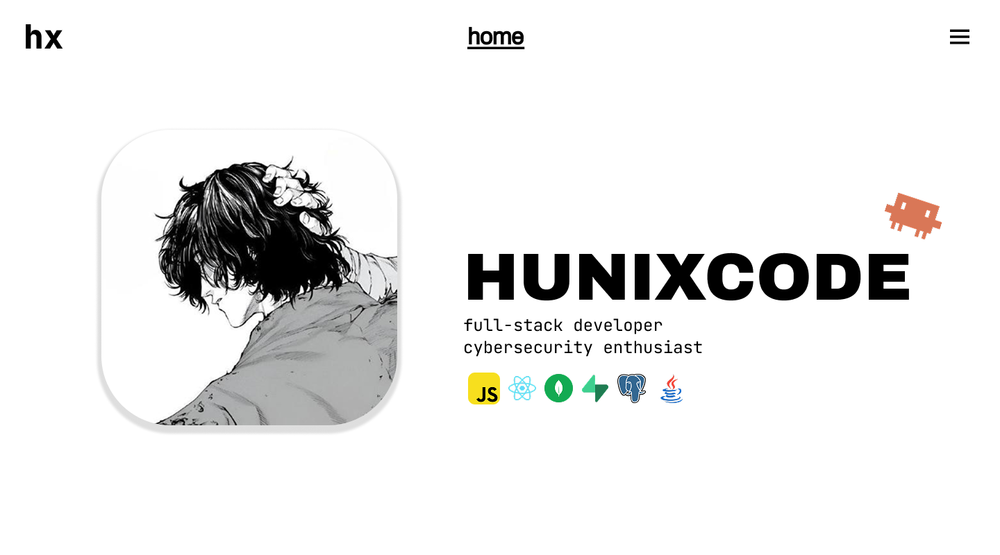
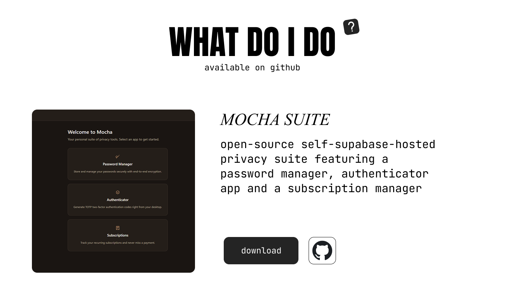
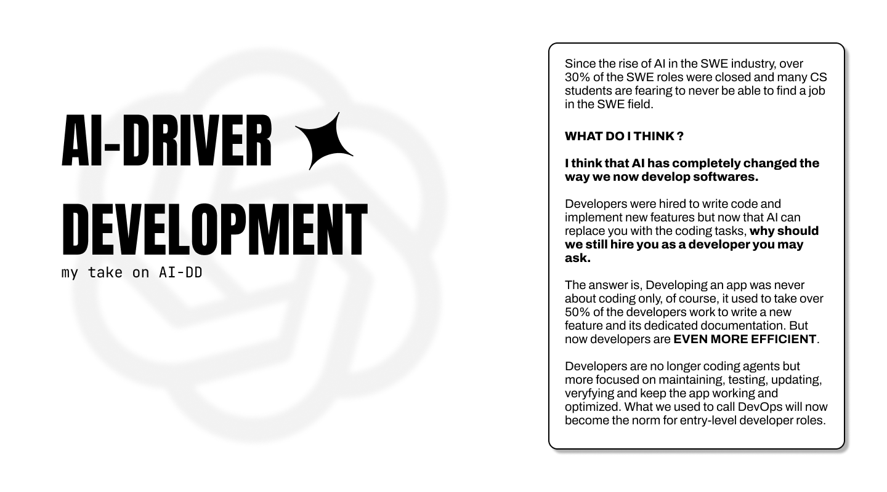
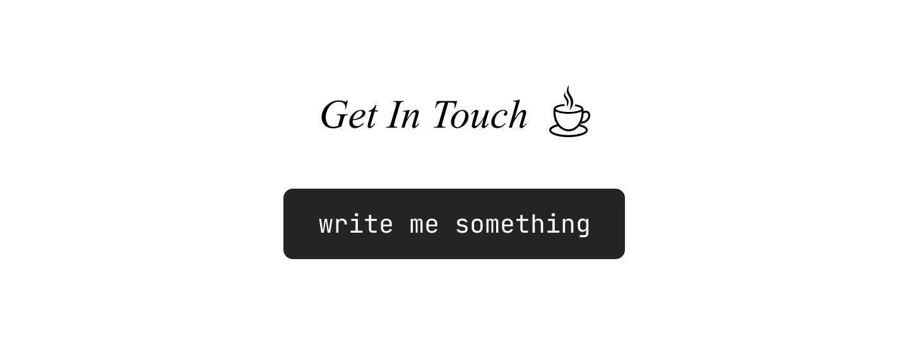

<div align="center">
    
    <h1>Iced Coffee</h1>
    <p>My hand-made personal portfolio made with React x Vite
        </br>Feel free to contribute if you feel like putting your footprint
        </br>somewhere on github
    </p>
    
    
</div>

# Overview

Why am I uploading my portfolio's source code publicly ?
This is basically a way for me to showcase my web development skills and how I manage a ReactJS project
feel free to open any issue if you find something I could potentialy work on.

## Quickstart

*Requirements : latest npm & nodejs versions*

If you wanna use my repository as a template for your own portfolio simply run this command :

```bash
git clone https://github.com/hunixcode/icedcoffee.git
```

**or**

download the *.zip file in the [releases](https://github.com/hunixcode/icedcoffee/releases) section if you don't want the git headers.

## Featuring

A single full-width page, black on white, following the original mockups below:

- Landing (avatar, name, stack, links to GitHub and resume)
- What do I do — project index linked to GitHub
- Downloads (latest GitHub releases, snapshotted at build time — `npm run releases` to refresh)
- AI-driven development — my take on AI-DD
- Contact

## Design

<div align="center">
    
    <p><em>Landing Page</em></p>
    
    <p><em>Projects</em></p>
    
    <p><em>AI-Driven Development</em></p>
    
    <p><em>Contact</em></p>
</div>
